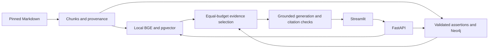

# NexusRAG

**Comparing Vector and Knowledge-Graph Retrieval for Architecture Documentation**

[](https://github.com/Atif-Bakhsh/NexusRAG/actions/workflows/ci.yml)

**Current finding:** both retrieval modes found complete labeled evidence for **11/12
answerable development questions (91.7%)**, across **12 frozen documents**. This is a
retrieval-only diagnostic using a **Mermaid-derived fixture graph**, with labels awaiting
independent human review. Generated-answer quality and LLM extraction are not measured yet.
[Raw results and limitations →](docs/report.md)

Architecture questions often require following relationships across services, stores and
brokers. NexusRAG tests whether adding explicit, source-backed graph paths helps compared
with a vector-only baseline. It preserves the evidence so an engineer can inspect where an
answer came from. It reads Astronomy Shop documentation; it does not run Astronomy Shop.

## What is built

- Two retrieval modes: exact vector search and graph + vector, plus independent UI comparison.
- 128 source-located chunks from 12 commit-pinned Markdown documents.
- 384-dimensional CPU BGE embeddings and a 35-assertion diagnostic graph.
- Four bounded graph-query families, with source evidence for each relationship.
- Structured generation, citation validation, query traces, token/cost accounting and a paid-call disable switch.
- A 40-question evaluation set: 16 development / 24 held-out, with a human judgment workflow.

**Stack:** Python 3.12 · FastAPI · Pydantic · PostgreSQL/pgvector · Neo4j Community ·
Sentence Transformers/BGE · OpenAI SDK · Streamlit · SQLAlchemy/Alembic · Docker Compose · pytest.



## Run the free local demo

Requires Docker Desktop/Compose and internet for initial image/model downloads.
Around 16 GB RAM is recommended. No API key is needed for this workflow.

```sh
git clone https://github.com/Atif-Bakhsh/NexusRAG.git
cd NexusRAG
cp .env.example .env
DISABLE_PAID_API=true docker compose up -d --build --wait
docker compose exec -T api nexusrag download-model
docker compose exec -T api nexusrag ingest --fixture-graph
docker compose exec -T api nexusrag preflight --require-ready
docker compose exec -T api nexusrag ask \
  'How does Checkout reach Quote through Shipping?' \
  --mode graph_vector --retrieval-only
```

Inspect returned evidence, paths and the query ID. Open [Streamlit](http://127.0.0.1:58501)
to load that ID in **Evidence and execution**, or view the committed diagnostic in
**Benchmark results**. [API docs](http://127.0.0.1:58000/docs) expose the seven endpoint patterns.

The UI's Ask/Compare flow generates answers and needs explicit live configuration.
The free CLI retrieves real evidence without fabricating an answer.
Stop with `docker compose down`; database/model volumes and artifacts remain.

## How the experiment is evaluated

Both modes use the same snapshot, embedding model, generator, prompt and limits:
up to **8 chunks / 3,000 evidence tokens**. Graph mode preserves complete path evidence
before filling remaining slots with vector results. Graph queries have a **3-hop limit**,
**20-path cap** and **2-second timeout**.

Candidate Recall/Precision/MRR/nDCG are evaluated at K=5/10/20. Complete final-context
evidence is scored separately. Humans judge correctness, faithfulness, citation support,
coverage and abstention; a valid citation pointer does not prove its claim.

```sh
# Free development diagnostic; explicitly permits draft labels and the fixture:
docker compose exec -T api nexusrag evaluate --split dev --allow-unreviewed
```

The diagnostic tied; it does not demonstrate a graph advantage. The architecture diagram
is available to both systems. Documented dependencies do not prove outage propagation.

## Documentation and remaining work

| Guide | Contents |
| --- | --- |
| [Architecture](docs/ARCHITECTURE.md) | Modules, storage, ingestion, retrieval and query lifecycle |
| [Runbook](docs/RUNBOOK.md) | Installation, queries, Make commands, tests, inspection and recovery |
| [Configuration](docs/CONFIGURATION.md) | Every supported environment variable and paid-use boundary |
| [Troubleshooting](docs/TROUBLESHOOTING.md) | Likely setup and runtime failures |
| [Final experiment](docs/FINAL-EXPERIMENT.md) | Reviewed LLM extraction, held-out runs and human scoring |
| [Demo](docs/DEMO.md) | Three-minute portfolio walkthrough |
| [Completion report](PROJECT_COMPLETION_REPORT.md) | Verified checks, audit findings and remaining limitations |
| [Resume](docs/RESUME.md) | Quantified, evidence-backed project bullets |

Before claiming the final result: independently review the 40 labels, run and review live
LLM extraction, freeze settings, evaluate the 24 held-out questions, complete human judgments,
and record the demo. These steps have not been completed.

The project is designed for local use, not direct public deployment.
Corpus material is attributed to the [OpenTelemetry Authors](corpus/ATTRIBUTION.md) under
[CC-BY-4.0](corpus/UPSTREAM-LICENSE). An original-code license has not yet been selected.
