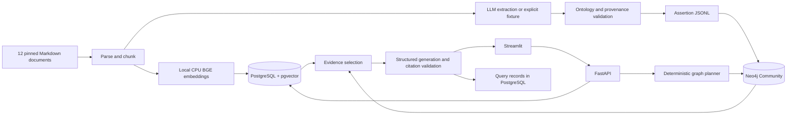

# NexusRAG architecture

NexusRAG compares two retrieval strategies over one frozen set of architecture documentation.
It reads Astronomy Shop documentation; it does not run Astronomy Shop. Four local Compose
services run the application. Ingestion and evaluation are CLI processes in the same Python
package, not additional services.

## System map



The OpenAI API is the only paid integration. Embeddings run on CPU. The basic workflow uses
the fixture graph and retrieval-only CLI, with paid calls disabled. The architecture has no
router LLM, agent framework, queue, crawler, reranker or extra vector store.

## Repository map

| Location | Responsibility |
| --- | --- |
| `src/nexusrag/config.py`, `models.py` | Environment settings and strict Pydantic data contracts |
| `ingestion/` | Manifest validation, Markdown chunking, sequential ingestion |
| `retrieval/` | Pinned BGE inference and complete evidence-bundle selection |
| `graph/` | Alias registry, ontology validation, fixture parser, planner, Cypher templates |
| `generation/` | Grounding prompt, structured Responses API client, citations, local spend ledger |
| `db.py` | SQLAlchemy tables and exact pgvector queries |
| `service.py` | Shared retrieval/generation orchestration and observable stage records |
| `api/app.py`, `ui.py` | FastAPI endpoints and three Streamlit views |
| `cli.py`, `preflight.py` | Explicit local operations and read-only readiness diagnostics |
| `evaluation/` inside the package | Gold-span mapping, ranking metrics, paired runner, human scoring |
| Root `evaluation/` | 40 draft questions, source-span labels and human review instructions |
| `corpus/` | 12 original Markdown files, source/hash manifest, aliases and attribution |
| `migrations/` | Alembic versioned PostgreSQL schema |
| `tests/` | Mocked unit, real database integration, cached-model and UI tests |
| `scripts/` | Pinned corpus download, draft-label authoring, container smoke test |
| `results/development-diagnostic/` | Committed historical fixture diagnostic and raw outputs |
| `artifacts/`, `results/runs/` | Ignored local ingestion exports, spend ledger and new benchmarks |
| `docs/`, `Makefile`, Compose, CI | Explanation, repeatable commands and free verification |

Do not rerun `scripts/author_labels.py` over human edits: it recreates the draft labels.

## Ingestion and document chunking

1. Read the fixed local manifest. Verify exactly the 12 allowed document IDs, safe Markdown
   paths, pinned source URLs and every SHA-256 content hash. Ordinary ingestion never crawls.
2. Derive an index identity from the manifest digest, source version, chunker version, BGE
   model/revision, alias hash, extraction model/prompt and graph source.
3. Parse YAML frontmatter and Markdown blocks using Markdown-it. Track nested headings.
   Preserve original paragraphs, lists, tables and code/Mermaid source.
4. Pack blocks within sections, targeting 256 BGE tokens. The hard maximum is 320, including
   title/section prefixes and tokenizer special tokens. Split oversized blocks on source
   lines, with up to 32 tokens of whole-line overlap. A single oversized line fails explicitly.
5. Store normalized 384-dimensional BGE embeddings and chunks in PostgreSQL.
6. Obtain assertions from per-chunk structured extraction, an exported JSONL file, or the
   explicit Mermaid fixture. Cache validated extraction results to resume an interrupted pass.
7. Check canonical entities, endpoint types, exact supporting quotes, source corpus and
   canonical assertion IDs. Export portable assertion/chunk JSONL.
8. Import graph entities and assertions. Check graph readiness, then mark PostgreSQL ready.

Chunk IDs hash document version, chunker version, source positions and content. Each chunk
carries title, section, pinned URL, exact one-based inclusive line range, content hash and
optional document date. Markdown page numbers are null.

New-version ingestion failures remain unavailable. Existing ready versions remain readable.
Reruns of an intact ready index are no-ops. Imports are not cross-database transactions:
readiness is the publication gate. The latest created ready corpus is selected for queries.
Avoid concurrent ingestion during benchmarking.

The manifest-digest fix changes new index IDs compared with the committed diagnostic.
Its historical IDs and raw outputs are intentionally preserved.

## Embeddings and PostgreSQL

`BAAI/bge-small-en-v1.5` is pinned to revision
`5c38ec7c405ec4b44b94cc5a9bb96e735b38267a`. Sentence Transformers runs on CPU and normalizes
passage and question vectors. Questions receive the BGE retrieval instruction prefix.
Questions exceeding the model's 512-token input limit are rejected.

PostgreSQL stores `corpora`, `documents`, `chunks`, `query_runs`, and Alembic's version table.
Chunks use `vector(384)`. Exact cosine distance is ordered with chunk-ID tie-breaking; there
is no approximate vector index. Queries filter the active ready corpus and optional document
IDs before retrieving up to 20 candidates.

## Graph storage and retrieval

Neo4j stores corpus-scoped `:Entity` nodes and a `:Corpus` import marker. Stable keys combine
corpus version and canonical entity ID. Entity payloads include aliases, source mentions,
resolution method and review status.

| Predicate | Stored direction |
| --- | --- |
| `CALLS` | Service → Service |
| `USES_STORE` | Service → DataStore |
| `PUBLISHES_TO` | Service → MessageBroker |
| `CONSUMES_FROM` | Service → MessageBroker |

Relationships retain assertion IDs, corpus version and full provenance payloads. Readiness
compares the marker's assertion count with stored relationship count. Preflight additionally
checks all assertion source chunks, quotes and canonical IDs. These checks do not establish
semantic truth and are not a full database-corruption detector.

Resolution uses case/punctuation normalization and a versioned alias map. Longest boundary
matches avoid interpreting “Frontend Proxy” as “Frontend.” Alias collisions fail validation;
unknown entities are rejected. There is no embedding-based merging.

The deterministic planner recognizes four families: direct neighbors; bounded call/storage
paths (including reverse callers); producer–broker–consumer flows; and shared direct CALLS
targets. A messaging path traverses CONSUMES_FROM backward while preserving its stored meaning.

Templates are developer-owned Cypher with parameterized IDs. Each path has at most three
relationships, no repeated nodes, and corpus-scoped nodes/edges. A query returns at most 20
paths; a 21st row marks truncation. The read timeout is two seconds. The planner records its
matched entities, match method, template, clarification or fallback reason. Unsupported
phrasing uses vector evidence. Graph failure is explicitly recorded before vector fallback.

## Vector versus graph + vector

Both modes use the same vector search and grounding prompt. Vector mode fills context from
ranked candidates. Graph mode first selects at most two graph paths and their entire source
chunk bundles, then fills remaining space from vector candidates.

Both contexts are limited to eight distinct chunks and 3,000 serialized evidence tokens.
Missing, out-of-filter, invalid or oversized path bundles are discarded with recorded reasons.
An incomplete path is never displayed as supported. Graph metadata supplements the source
passages; generated graph descriptions do not replace evidence.

## Answer generation and citations

Generation uses the configured pinned OpenAI model, structured JSON Schema and reasoning
disabled. The normal path makes one generation call; malformed output or invalid citation IDs
permits one repair. Provider timeouts do not trigger SDK retries. Deterministic clarification
can return without a call. DISABLE_PAID_API stops calls before spend reservation or client creation.

Answers contain a status, cited statements and limitations. Each factual statement requires
evidence IDs present in the supplied active-corpus context. The application creates titles,
URLs and line links from verified metadata. Unknown citations, duplicate context and mixed
corpora fail validation. A valid pointer does not prove entailment: humans judge claim support.

The local SQLite spend ledger reserves estimated cost before a call, settles known token usage,
and conservatively retains reservations when usage is unknown. It is an application estimate,
not provider billing. Preserve it across resets.

## Query lifecycle

```mermaid
sequenceDiagram
    participant U as Streamlit
    participant A as FastAPI
    participant S as QueryService
    participant P as PostgreSQL
    participant N as Neo4j
    participant L as OpenAI
    U->>A: POST /ask with explicit mode
    A->>S: Validate request and acquire query lock
    S->>P: Active corpus and exact vector candidates
    opt graph_vector mode
        S->>N: Parameterized bounded template
        N-->>S: Paths and source references
        S->>P: Original supporting chunks
    end
    S->>S: Select complete evidence under equal budgets
    opt Generation enabled and no deterministic clarification
        S->>L: Structured grounded answer
        L-->>S: Statements and evidence IDs
        S->>S: Validate citations; at most one repair
    end
    S->>P: Save result, timings, usage and observable trace
    S-->>A: Answer, evidence, paths and query ID
    A-->>U: Render citations and execution details
```

Compare is two independent ordinary HTTP requests. The HTTP endpoint generates answers;
retrieval-only is currently a CLI option. The API serializes requests with a lock and returns
429 when busy. Liveness is `/health`; database/corpus readiness is `/ready`; comprehensive
model/migration/provenance checks are `nexusrag preflight`. Query records omit credentials and
hidden chain-of-thought, but do contain questions and source text.

## Evaluation and the two graph sources

The fixture converts recognized explicit Mermaid arrows from the architecture document.
It currently has 35 assertions and is labeled `mermaid_fixture`. It is useful for testing
retrieval, not measuring an LLM extractor. The LLM graph uses structured extraction over all
128 chunks with a fixed entity registry. They have different index identities and must not
be reported interchangeably. Both systems see the original architecture diagram.

Forty draft questions are grouped into 16 development and 24 held-out questions. Labels use
source spans, alternative support sets, expected behavior, entity matches and template family.
They remain agent source-checked until independently reviewed.

The runner freezes settings, ingestion configuration, label hash and a copy of labels. It
alternates arm order, uses one embedding warmup, records paired raw outputs and refuses an
active-corpus change. Candidate Recall/Precision/MRR/nDCG are scored at 5/10/20; complete
final-context evidence is the main multi-hop retrieval measure. No-answer recall is null.

Generation is opt-in. A CSV receives human correctness and claim-support judgments. Scoring
requires complete rows and consistent counts. It reports correctness, faithfulness, citation
support/coverage, unsupported claims and abstention separately. Three repetitions measure
variability; they do not turn 24 questions into 72 independent questions.

The deployment boundary is local only: loopback ports, authenticated databases, no accounts,
document permissions, public rate limiting, TLS or disaster-recovery automation.
