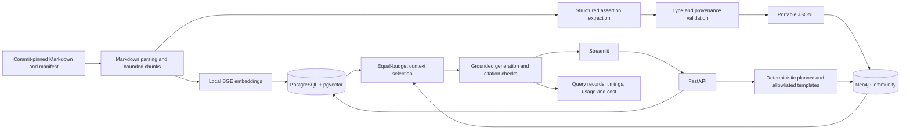

# NexusRAG technical design

NexusRAG compares vector retrieval with graph-augmented retrieval over the same twelve
frozen Astronomy Shop Markdown documents. Neo4j is a learning choice; this graph does
not require a separate database for scale. The system does not run Astronomy Shop.

## Ingestion and versioning

`corpus/manifest.json` pins the upstream commit, exact paths and SHA-256 hashes.
`prepare()` derives an index version from source snapshot, embedding revision, chunker,
alias-map hash, extraction model/prompt version and graph source. A Mermaid fixture and
an LLM graph therefore cannot share a version. Change these versions when behavior changes.

The Markdown parser identifies heading/paragraph/list/table/code blocks. The packer groups
blocks within sections, retaining unmodified source text and exact line ranges. Oversized
blocks split only on line boundaries with at most 32 embedding-token overlap; oversized
individual lines fail explicitly. BGE counts include title/heading prefixes and special
tokens; every chunk is at most 320 tokens, targeting 256. Document date is null when absent.
All vectors are normalized; queries use the BGE model card's retrieval prefix. Exact cosine
search has a stable chunk-ID tie break and filters ready corpus plus optional document IDs.

Ingestion is sequential. Each extraction response is cached, validated and exported.
PostgreSQL is marked ready only after graph import succeeds and every reference resolves.
A failure leaves a staged version unavailable; ready versions remain readable. Re-ingestion
is idempotent. Neo4j can be rebuilt with the exported assertions and no new extraction calls.
`--fixture-graph` exists solely for unpaid smoke tests and provisional retrieval diagnostics.

## Graph and retrieval

Entity types: Service, DataStore, MessageBroker. The only predicates are CALLS, USES_STORE,
PUBLISHES_TO, CONSUMES_FROM. Consumption is stored Service → Broker; message-flow traversal
reverses that edge. Canonical IDs and aliases are explicitly versioned. Unknown IDs,
alias collisions, bad endpoint types, missing chunks and unmatched quotes are rejected.
Semantic truth is **not** established by quote matching; extraction needs human review.

The planner records matched IDs, a template family, match method, clarification or fallback.
No confidence number is fabricated. Templates are developer-owned, use parameters for
names, limit traversal to three edges, forbid node repetition, return at most twenty paths,
and use a two-second database timeout. A twenty-first result marks truncation.
Questions never become executable Cypher. Unsupported phrasing falls back to vector evidence;
ambiguous relations such as “upstream” ask for clarification. This deliberately limited
planner is measured separately and may miss synonyms and implicit references.

Both modes start from the same twenty vector candidates. Graph mode takes at most two paths,
keeping **all** supporting chunks, then fills remaining slots from vector candidates. Paths
that cannot fit eight chunks / 3,000 serialized evidence tokens are discarded with a reason.
Graph metadata contains references, not a second copy of source quotes in the generation
prompt. Displayed edge excerpts are validated against the retained chunks.

## Generation and cost

The Responses API uses `gpt-5.4-mini-2026-03-17`, `reasoning.effort=none`, strict JSON Schema,
no tools, no stored provider response, a 45-second timeout and no SDK retry loop. The normal
path makes one call. Invalid schema/citations permit one repair; a timeout does not trigger
a hidden retry. Each factual statement requires evidence IDs. The application creates source
links from the pinned manifest. Unsupported questions abstain. Hidden reasoning is neither
requested nor stored.

A SQLite ledger in `artifacts/spend.sqlite` reserves worst-case estimated call cost before
network activity. Atomic reservations cover concurrent processes sharing the artifacts
volume. Measured token usage replaces reservations; unknown usage retains the reservation.
Prices are uncached estimates, not invoices. Preserve this ledger across runs: deleting it
resets application accounting. The application ceiling is $50 and can be lowered in `.env`.
Set a matching provider project limit for account-level control.

## Local boundary

Four Compose services, loopback host ports, authenticated databases, bounded Neo4j memory,
no upload endpoint and no public deployment. Source content is untrusted context. API keys
stay in server environment, are absent from query records and never reach Streamlit. Query
records deliberately retain user questions and source text on this local machine. This
configuration is not intended for public exposure.

## Evaluation limitations

Source-span labels survive chunk changes. A complete support set requires every span to be
covered, with alternatives accepted. Candidate scores at K=5/10/20 describe vector candidates;
final-context scores describe what generation sees. Precision divides by the number actually
retrieved. Repeated IDs are removed. No-answer recall is undefined. Human claim counts measure
correctness, faithfulness, citation support and coverage separately.

The 16/24 split groups related route questions. The service diagram is available equally to
both systems. Specified routes are constrained-path tasks, not minimum-hop discoveries.
A versus B says nothing about stronger lexical/reranking/decomposition baselines. Repetitions
measure variability, not new independent questions. P95 uses nearest rank and reports n;
small samples are descriptive only. Missing graph paths are not evidence of missing real
connections, and dependency diagrams are not outage predictions.
